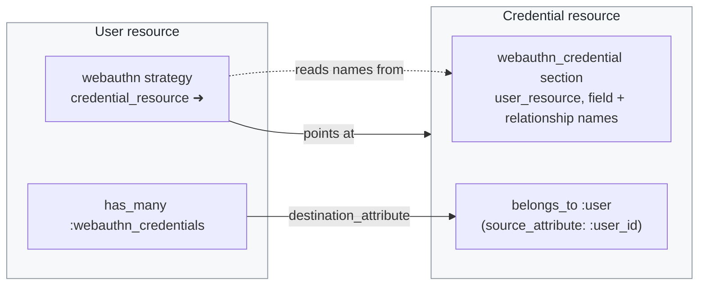
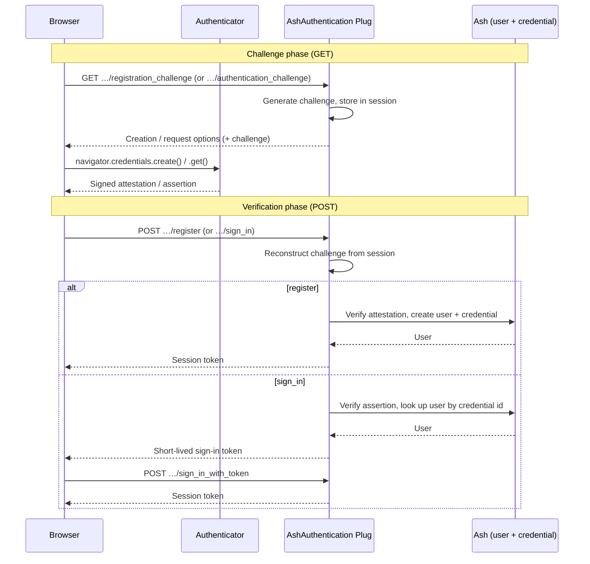

<!--
SPDX-FileCopyrightText: 2026 Alembic Pty Ltd

SPDX-License-Identifier: MIT
-->

# WebAuthn (Passkeys) Tutorial

The WebAuthn strategy authenticates users with FIDO2 hardware security keys
and passkeys — phishing-resistant, public-key credentials verified by the
browser and authenticator rather than a shared secret.

## Prerequisites

- AshAuthentication configured with a User resource
- The optional [`wax_`](https://hex.pm/packages/wax_) dependency, which
  backs the default ceremony adapter:

  ```elixir
  {:wax_, "~> 0.7"}
  ```

  It brings the `cbor` codec the credential resource stores public keys
  with. A project on a [custom adapter](#the-ceremony-adapter) needs
  `{:cbor, "~> 1.0"}` instead of `wax_`.

- Tokens enabled (WebAuthn sign-in issues a token on success)

## Setup

Create a credential resource using the `AshAuthentication.WebAuthnCredential`
extension. It scaffolds the required attributes, relationship, identity, and
actions for you:

> #### The extension is required {: .info}
>
> As of 5.0 the credential resource must use this extension. Its
> `webauthn_credential` section is the single place the credential's attribute
> names, its `belongs_to` to the user resource, and its action names are
> configured — the `webauthn` strategy reads them back from there rather than
> declaring its own copies.
>
> Support for a credential resource without the extension may return in a
> later minor version.

```elixir
defmodule MyApp.Accounts.WebAuthnCredential do
  use Ash.Resource,
    domain: MyApp.Accounts,
    data_layer: AshPostgres.DataLayer,
    extensions: [AshAuthentication.WebAuthnCredential]

  webauthn_credential do
    user_resource MyApp.Accounts.User
  end

  postgres do
    table "webauthn_credentials"
    repo MyApp.Repo
  end

  policies do
    bypass AshAuthentication.Checks.AshAuthenticationInteraction do
      authorize_if always()
    end
  end
end
```

Then add the strategy to your user resource:

```elixir
authentication do
  strategies do
    webauthn do
      credential_resource MyApp.Accounts.WebAuthnCredential
      rp_id "example.com"
      rp_name "My App"
      require_identity? true
    end
  end
end
```

Run `mix ash.codegen add_webauthn` to generate the migrations.

### How the two resources fit together

The credential resource's `webauthn_credential` section is the single source
of truth for the credential's shape: it names the attributes, and it names the
`belongs_to` back to the user. The strategy only points at the credential
resource (`credential_resource`) and reads those names back from it — it never
declares its own copies. On the user side, the strategy builds a matching
`has_many`; both ends meet on the credential's one foreign key.



If the user resource isn't named `User`, the generated `has_many` derives its
foreign key from that resource's name (`Account` ➜ `:account_id`), so the
credential's `belongs_to` has to be named to match — set
`user_relationship_name` on the `webauthn_credential` section and everything
else follows from it. `mix ash_authentication.add_strategy.webauthn` does this
for you.

> ### Migrating from a legacy U2F deployment? {: .warning}
>
> Security keys registered through the pre-WebAuthn **FIDO U2F** JavaScript
> API are scoped to a legacy *AppID* URL rather than a WebAuthn RP ID, and
> will **not** respond to challenges issued by this strategy. The WebAuthn
> `appid` extension — the compatibility bridge that lets U2F-era credentials
> keep working — is **not implemented** here. If you are migrating an
> existing user base to AshAuthentication and still have U2F-registered keys
> in circulation, those users must re-register their keys as WebAuthn
> credentials (e.g. via the `add_credential` flow after signing in with
> another factor). New deployments are unaffected: the U2F API was removed
> from browsers in 2022, so no new U2F credentials can exist.

### The ceremony adapter

All cryptographic ceremony work goes through a swappable backend adapter
(see `AshAuthentication.Strategy.WebAuthn.Adapter`). The default uses the
`wax_` library; you only need to care about this if you want to replace or
instrument the ceremony implementation:

```elixir
webauthn do
  adapter MyApp.CustomWebAuthnAdapter
  # ...
end
```

The adapter owns the whole backend. It generates and verifies challenges,
says which signature algorithms it can verify (sent to the browser as
`pubKeyCredParams`), and reports its own dependencies: a strategy on a
custom adapter doesn't need `wax_` installed, and a missing `wax_` is only a
compile error for strategies using the default adapter. The one dependency
that stays is `cbor`, which the credential extension's `CoseKey` type uses
to store public keys — COSE keys are CBOR by specification, whatever
verifies them.

## Discoverable and non-discoverable credentials

Every WebAuthn credential is one of two kinds, and the kind decides how its
owner can sign in.

**Discoverable credentials**, also called *resident keys*, are what "passkey"
usually means. The authenticator stores them: for each site it keeps a record
holding the private key, the relying party ID and the user handle. When the
browser asks for a credential for `example.com` without naming any, the
authenticator looks through its own records and offers what it finds. That is
how "sign in with a passkey" works without typing a username first. Every
synced passkey (iCloud Keychain, Google Password Manager, password managers
such as 1Password) is discoverable.

**Non-discoverable credentials**, also called *server-side credentials*, are
not stored on the authenticator. On a typical security key the credential ID
handed back at registration *is* the private key, encrypted with a secret that
never leaves the key, and the server keeps that ID. To sign in, the server has
to send the ID back in `allowCredentials`; the key decrypts it and signs.
Without the ID, the key has nothing to offer. This is how the legacy FIDO U2F
API worked, and why it always needed a username first.

### Which kind this strategy needs

Sign-in challenges never list credentials: `allowCredentials` is always empty,
because the challenge endpoint is public and listing a submitted identity's
credentials would disclose them (see [Identity + passkey](#identity-passkey)).
So **only discoverable credentials can sign in**, whether or not the strategy
requires an identity.

The second-factor `verify_challenge` is different. Its caller is already
authenticated, so it lists that user's credentials, and both kinds work there.

### How the kind is decided

`resident_key` controls what registration asks the authenticator for:

| `resident_key` | Asks for | What you get |
|---|---|---|
| `:required` (default) | A discoverable credential | Discoverable, or registration fails. Nobody silently ends up with a passkey that can't sign in |
| `:preferred` | Discoverable if possible | Usually discoverable, but the authenticator may fall back to non-discoverable, e.g. a security key whose storage for discoverable credentials is full (older YubiKeys hold 25) |
| `:discouraged` | A non-discoverable credential | Usually non-discoverable, so it can't sign in |

Keep `:required` for any strategy that signs users in; the strategy warns at
compile time otherwise. `:preferred` or `:discouraged` make sense only for a
second-factor-only strategy (`sign_in_enabled? false`), where they also spare
the limited storage on hardware keys.

### Telling them apart afterwards

At registration the strategy asks the browser to report whether the
credential it created is discoverable (the `credProps` extension), and stores
the answer in the credential's `discoverable` attribute: `true`, `false`, or
`nil` when the browser didn't report. A credential with `discoverable: false`
can be used for `verify` but not to sign in.

## Configuration modes

The strategy supports four distinct configurations. Pick the row that matches
your product and use its settings as a starting point.

Identity mode is the default: `require_identity?` defaults to `true`, so a
`webauthn` block that doesn't set it expects an `identity_field` on the user
resource. Passkey-first mode is an explicit opt-in with
`require_identity? false`.

| Mode | Key settings | User resource needs | How sign-in works |
|------|--------------|---------------------|-------------------|
| **Identity + passkey** (classic) | `require_identity? true` | An `identity_field` attribute (default `:email`), unique and writable | Discoverable passkey; the credential id resolves the user, and an identity, if submitted, must match its owner |
| **Passkey-first** (no identity column) | `require_identity? false`, `resident_key :required` | No identity attribute at all | Fully discoverable: the browser offers stored passkeys and the credential id resolves the user |
| **Second factor only** | `registration_enabled? false`, `sign_in_enabled? false`, `verify_enabled? true` | Another primary strategy (e.g. password) | The `verify` phase proves possession on top of an authenticated session, stamping `webauthn_verified_at` |
| **Multi-tenant** | `rp_id`/`rp_name`/`origin` as MFA tuples, 1-arity functions, or `AshAuthentication.Secret` modules | Same as the mode it combines with | Relying-party identity resolved per tenant at ceremony time |

### Identity + passkey

```elixir
webauthn do
  credential_resource MyApp.Accounts.WebAuthnCredential
  rp_id "example.com"
  rp_name "My App"
  identity_field :email
  require_identity? true
end
```

The identity is stored at registration. Sign-in works as in passkey-first
mode: the authentication challenge leaves `allowCredentials` empty, the
browser offers the discoverable passkeys it holds for the site, and the
credential id resolves the user. An identity submitted with the `sign_in`
request is optional, and if present must match the credential's owner.

> #### Why `allowCredentials` is always empty {: .info}
>
> `authentication_challenge` is a public, unauthenticated endpoint. Listing
> the credentials of a submitted identity would tell anyone who knows or
> guesses that identity whether the account exists and what its credential ids
> are, so the challenge never lists any — the same reason the public
> `registration_challenge` leaves `excludeCredentials` empty.
>
> The consequence is that only **discoverable** credentials can sign in (see
> [Discoverable and non-discoverable credentials](#discoverable-and-non-discoverable-credentials)).
> Keep `resident_key :required` (the default); the strategy warns at compile
> time if `resident_key` would let an authenticator create a credential that
> can't be discovered. The second-factor `verify_challenge`, whose caller is
> already authenticated, still lists the actor's credentials.

### Passkey-first

```elixir
webauthn do
  credential_resource MyApp.Accounts.WebAuthnCredential
  rp_id "example.com"
  rp_name "My App"
  require_identity? false
  resident_key :required
end
```

Since there is no identity to display, the client should pass a
`display_name` parameter with the registration challenge request — it becomes
the account name shown in the passkey picker. (This is distinct from the
credential's `label`, which names the individual key/device in your own UI.)

> #### New devices and account recovery {: .warning}
>
> With no identity and no other strategy, a user's passkeys are the only way
> into the account, and enrolling another one (`add_credential`) requires
> being signed in. A new device can be bootstrapped by a synced passkey (the
> platform's passkey manager carries it over) or by signing in with a phone
> through cross-device `hints [:hybrid, ...]` and then enrolling. A user whose
> only passkeys are device-bound (a security key, or a platform authenticator
> that doesn't sync), on a site that doesn't offer `:hybrid`, has neither:
> losing those devices loses the account. Recovery in that case is the
> application's responsibility, e.g. encouraging a second passkey at
> registration, or providing an out-of-band recovery flow.

### Second factor

```elixir
webauthn do
  credential_resource MyApp.Accounts.WebAuthnCredential
  rp_id "example.com"
  rp_name "My App"
  require_identity? true
  registration_enabled? false
  sign_in_enabled? false
end
```

Both flags matter. Registration is a sign-in in its own right: a successful
`register` creates the user and returns a session token. Leaving
`registration_enabled?` at its default would let anyone create a passwordless
account through the public `registration_challenge`/`register` endpoints and be
signed in without the primary factor. With both off, the strategy exposes only
`verify` and `add_credential`, and both require an authenticated actor.
`mix ash_authentication.add_strategy.webauthn --mode 2fa` generates this
configuration.

### Multi-tenant

Multi-tenancy combines with any of the modes above. What it needs:

- **The credential resource shares the user resource's multitenancy.** Use
  the same strategy (`:context` or `:attribute`) on both, so a credential
  lives in the same tenant as its user. Every credential lookup in a ceremony
  (by credential id, by actor, when listing) runs in the request's tenant, so
  a passkey registered in one tenant is unknown in every other.
- **The tenant is set on the connection** (`Ash.PlugHelpers.set_tenant/2`)
  before the strategy's routes, as for any multi-tenant AshAuthentication
  resource. Drivers of `Actions` pass `tenant:`.
- **A relying party per tenant, if tenants have their own domains.** `rp_id`,
  `rp_name` and `origin` each take a 1-arity function or an MFA receiving the
  tenant. Passkeys are bound to their `rp_id`, so a tenant that changes domain
  can't use the passkeys registered under the old one.

```elixir
webauthn do
  credential_resource MyApp.Accounts.WebAuthnCredential
  rp_id {MyApp.WebAuthn, :rp_id_for_tenant, []}
  rp_name {MyApp.WebAuthn, :rp_name_for_tenant, []}
  origin {MyApp.WebAuthn, :origin_for_tenant, []}
  require_identity? true
end
```

> ### Origins, ports and proxies {: .warning}
>
> The WebAuthn origin is scheme + host + port, and the server checks it
> against the origin the browser reports. Where the expected origin comes
> from, in order:
>
> 1. **The request**, for every ceremony served by the strategy's plugs. The
>    origin is rebuilt from the challenge request's `scheme`, `host` and
>    `port`, and **takes precedence over a configured `origin`**.
> 2. **The configured `origin`**, when there is no request to read it from:
>    the actions driven directly, e.g. from a LiveView that doesn't pass
>    `origin:`.
> 3. **`https://{rp_id}`** otherwise. This omits the port, so it fails for a
>    development server on a non-standard port.
>
> Because the request wins, the connection has to describe the URL the
> browser actually used. Behind a TLS-terminating proxy or load balancer the
> raw connection is usually `http` on an internal port, so the expected origin
> becomes something like `http://example.com:4000`, the browser reports
> `https://example.com`, and every ceremony fails. Restore the original
> scheme, host and port before the router, for example with `Plug.RewriteOn`
> (`plug Plug.RewriteOn, [:x_forwarded_proto, :x_forwarded_host, :x_forwarded_port]`)
> or Phoenix's `force_ssl: [rewrite_on: ...]`, and only for headers your proxy
> sets.

## Cross-device sign-in (QR code / hybrid transport)

Browsers can offer a passkey held on *another* device:

```
[Camera]  Use your phone or tablet
          Scan this QR code with the camera on the device that has your passkey
[USB key] Use your security key
          Insert and touch your security key
```

This is **hybrid transport** (formerly caBLE), and it is implemented entirely
by the browser and the phone's operating system. The QR code, the Bluetooth
proximity check that stops it being phishable, and the tunnel carrying the
CTAP messages back to the browser are all outside this library — a
hybrid-signed assertion is indistinguishable from one produced by a USB key and
verifies through the same path. The server's only job is to ask for the option:

```elixir
webauthn do
  credential_resource MyApp.Accounts.WebAuthnCredential
  rp_id "example.com"
  rp_name "My App"
  require_identity? false
  resident_key :required

  hints [:hybrid, :security_key]
  timeout 300_000
end
```

`hints` orders the kinds of authenticator the browser should lead with:
`:hybrid` (another device, via QR), `:security_key` (removable USB/NFC), and
`:client_device` (this machine's built-in authenticator). It applies to
registration as much as to sign-in, so a machine with no authenticator of its
own can enrol a passkey held on a phone and then use it.

**Raise the timeout.** The 60 second default cannot accommodate a QR scan, a
Bluetooth handshake and a biometric prompt on the second device; the ceremony
expires mid-scan. Allow at least 120 seconds. The strategy warns at compile
time if you offer `:hybrid` with less. `timeout` bounds the whole ceremony:
the browser's dialog, the server-side challenge expiry, and the lifetime of
the token that makes each challenge single-use.

The phone needs no network route to your application — it talks to the browser,
not to you — so this works against `localhost` in development without a tunnel.

### Per-ceremony hints

Set `allow_hint_override? true` to let the client choose per ceremony:

```
GET /auth/user/webauthn/authentication_challenge?hints=hybrid
```

That is how a UI offers a dedicated "sign in with a phone" button which skips
the picker and goes straight to the QR code. Values outside the enum are
discarded and a request naming none of them falls back to the configured
`hints`. The parameter is safe to expose: `hints` only steers the dialog the
requesting browser shows itself, and every option that bears on verification
(`rp_id`, `origin`, `user_verification`, `allowCredentials`, attestation
policy) stays server-derived and is re-applied from the stored challenge.

### Browser support

`hints` is a WebAuthn Level 3 member, honoured by Chromium 128 and later.
Browsers that don't implement it ignore it and show their own picker — which
already includes the cross-device option — so no feature detection is needed
and nothing degrades. Note that `authenticator_attachment :platform` forbids
cross-device authenticators outright and contradicts `:hybrid`; the strategy
refuses that combination at compile time.

### Registering a phone passkey

Nothing extra is required. `registration_challenge` and
`add_credential_challenge` carry the same hints, and the resulting credential
is stored with `transports` including `"hybrid"` and `backup_eligible: true`.
Those transports are echoed in `allowCredentials` on second-factor `verify`
ceremonies, which lets the browser route straight back to the phone; sign-in
challenges list no credentials (see [Identity + passkey](#identity-passkey)),
and the browser's own picker offers the phone.

One asymmetry to be aware of: `add_credential` (which requires an authenticated
actor) populates `excludeCredentials`, so re-enrolling a phone that is already
registered is refused up front. The public `registration_challenge` endpoint
always sends an empty list — populating it from a submitted email address would
turn a public endpoint into an account-enumeration oracle — so a duplicate
enrolment there is caught by the unique-credential-id constraint instead.

## Attestation

By default the strategy uses `attestation "none"` — the right choice for
most consumer applications, where *which* authenticator model a user owns is
none of your business. The registration ceremony is fully verified either
way; attestation only concerns the authenticator's provenance.

For deployments that must only accept certain authenticators (e.g. corporate
policy requiring hardware-backed keys), tighten all three settings:

```elixir
webauthn do
  credential_resource MyApp.Accounts.WebAuthnCredential
  rp_id "example.com"
  rp_name "My App"
  require_identity? true

  attestation "direct"
  trusted_attestation_types [:basic, :attca]
  verify_trust_root? true
end
```

- `attestation` — what the client is asked to convey: `"none"`,
  `"indirect"` (anonymized allowed), `"direct"`, or `"enterprise"`
  (individually identifying; needs browser/authenticator support). This is a
  request, not a requirement: the client may answer any of them with a
  `"none"` statement (synced passkeys always do), and whatever it conveys is
  verified as such.
- `trusted_attestation_types` — which verified attestation types are
  accepted, and so the setting that actually enforces attestation policy. The
  default (`[:none, :basic, :self, :uncertain]`) accepts everything a consumer
  flow produces; restricting to `[:basic, :attca]` refuses registrations that
  don't chain to a known root, including `"none"` statements.
- `verify_trust_root?` — whether `packed`/`u2f` attestation statements are
  checked against trust anchors (`tpm` always is).

Verifying trust roots requires FIDO metadata, which the default adapter's
`wax_` library loads. Enable the FIDO Alliance MDS3 service:

```elixir
config :wax_, update_metadata: true
```

or ship metadata statements yourself via `config :wax_, metadata_dir: :my_app`
(reads `priv/fido2_metadata/` of that application). Without metadata, keep
`verify_trust_root? false` and include `:uncertain` in the trusted types.

## Ceremony phases

Each strategy instance exposes these routes (paths are prefixed with the
subject name and strategy name, e.g. `/user/webauthn/...`):

| Phase | Method | Purpose |
|-------|--------|---------|
| `registration_challenge` | GET | Creation options for registering a new user |
| `register` | POST | Verify attestation, create user + credential |
| `authentication_challenge` | GET | Request options for signing in |
| `sign_in` | POST | Verify assertion, issue token |
| `sign_in_with_token` | POST | Exchange a short-lived sign-in token for a session |
| `verify_challenge` | GET | Request options for second-factor verification |
| `verify` | POST | Prove possession as a second factor |
| `add_credential_challenge` | GET | Creation options for enrolling another passkey |
| `add_credential` | POST | Attach a new credential to the authenticated user |

Every ceremony is the same two round trips: a GET that mints a challenge and
stashes it in the session, then a POST that verifies the authenticator's
signed response against that stored challenge. Registration and sign-in differ
only in what the POST does once verification passes — create a user and
credential, or issue a token.



The `verify` (second factor) and `add_credential` (enroll another passkey)
ceremonies follow the same challenge-then-verify shape; they differ only in
requiring an already-authenticated actor and in what the POST does on success.

The `sign_in` and `verify` POSTs accept an optional `user_handle`, the
base64url-encoded `response.userHandle` from the assertion. When the
credential has a stored `user_handle` and the client sends one, they must
match (WebAuthn §7.2). Clients should always send it; a non-discoverable
credential returns none, which is accepted.

### Adding passkeys to an existing account

A passkey is a lasting way into an account, so who may add one deserves
thought. Two options control it:

- `add_credential_enabled? false` removes both `add_credential` phases, for
  apps that only enrol passkeys at registration or through their own flow.
- `add_credential_max_authentication_age {5, :minutes}` (seconds or a
  `{n, unit}` tuple) requires the user to have authenticated within that
  window; otherwise both phases fail before any challenge is issued, and the
  UI should ask them to sign in again or complete a second factor first.
  Signing in, a second-factor verification (`webauthn_verified_at` or
  `totp_verified_at`), or the issue time of the bearer token presented with
  the request all count; see
  `AshAuthentication.Strategy.WebAuthn.RecentAuthentication`. Unset by
  default, which lets any authenticated session add a passkey.

## Feature matrix

Status of this strategy against the WebAuthn specification (Level 2/3). This
section is maintained as the implementation evolves.

### Registration ceremony

| Spec feature | Status | Notes |
|---|---|---|
| Attestation verification | ✅ | By the adapter (`Wax.register/3` in the default one) |
| `rp` (id/name) | ✅ | Static or per-tenant |
| `user` (id/name/displayName) | ✅ | Random ≤64-byte handle for new users (no PII, per spec); stable, shared handle when adding credentials to an existing user. Persisted on the credential as `user_handle` |
| `pubKeyCredParams` | ✅ | Whatever the adapter can verify; the default adapter lists ES256, EdDSA, ES384/512, PS256/384/512, RS256/384/512 in preference order |
| `excludeCredentials` | ✅ | The actor's credentials when adding a passkey. Always empty on the public `registration_challenge` endpoint, so it can't reveal credential ids; a duplicate enrolment there is refused by the unique credential id |
| `authenticatorSelection` (attachment, residentKey, userVerification) | ✅ | All configurable. Whether a credential actually ended up discoverable is captured via `credProps` (see Extensions) |
| Attestation conveyance | ✅ | `"none"`, `"indirect"`, `"direct"`, `"enterprise"`; whatever statement is conveyed is verified and accepted per `trusted_attestation_types` (see [Attestation](#attestation)) |
| `timeout` | ✅ | Configurable; bounds the browser dialog and the server-side challenge alike |

### Authentication ceremony

| Spec feature | Status | Notes |
|---|---|---|
| Assertion verification | ✅ | By the adapter (`Wax.authenticate/6` in the default one) — origin, rpId, and the UV flag when `user_verification "required"` (also enforced at registration) |
| `allowCredentials` (identity-first) | ➖ | Deliberately not used for sign-in: the public challenge endpoint would disclose a submitted identity's credential ids. Used for second-factor `verify`, where the actor is authenticated (see [Identity + passkey](#identity-passkey)) |
| Discoverable / username-less flow | ✅ | How every sign-in works, in both identity modes; user resolved from the credential id. Requires discoverable credentials (`resident_key :required`, the default) |
| Returned `userHandle` | ✅ | Checked against the stored `user_handle` when the client sends it (`user_handle` param). Not required: non-discoverable credentials return none, and the user is always resolved from the credential id |
| Passkey-first mode (no identity column) | ✅ | `require_identity? false` |
| `transports` hints | ✅ | Captured from the client at registration (sanitized against the spec-registered set), echoed in `allowCredentials` on `verify` challenges |
| Sign counter (clone detection) | ✅ | Enforced per §6.1.1; `sign_count_policy :reject` (default), `:log`, or `:ignore`. Synced passkeys (constant zero counters) are never flagged |
| Backup flags (BE/BS) | ✅ | Stored as `backup_eligible`/`backed_up`; backup state refreshed on every assertion |
| Conditional UI / autofill mediation | ⚠️ | Server-side compatible (empty `allowCredentials`); wiring is a client concern |

### Extensions

| Extension | Status |
|---|---|
| `credProps` | ✅ Requested at registration; the client-reported `rk` result is stored as `discoverable` on the credential (nullable — browsers may omit it) |
| `appid` (U2F migration) | ❌ Not planned |
| `prf`, `largeBlob`, `credProtect` | ❌ Not planned |

### Credential lifecycle

| Flow | Status |
|---|---|
| Register new user (incl. custom `register_action_accept` fields) | ✅ |
| Sign in + short-lived token exchange | ✅ |
| Second-factor / step-up verification | ✅ |
| Add additional passkeys to an existing user (can be disabled, or require recent authentication) | ✅ |
| List / relabel / delete credentials (last-credential protection) | ✅ |
| `last_used_at` tracking | ✅ |

## Security defaults worth knowing

- `sign_count_policy :reject` — assertions whose signature counter did not
  increase are rejected as possible cloned authenticators. Use `:log` for a
  monitoring-only rollout. Under `:log` a flagged assertion is allowed but
  leaves the credential record untouched: the stored count stays at its
  high-water mark so a clone keeps tripping the check, and `last_used_at` and
  `backed_up` aren't refreshed for that use either.
- `user_verification "preferred"` — raise to `"required"` for step-up or
  high-security deployments.
- Deleting a user's last credential is refused, so an account with WebAuthn
  as its only strategy cannot lock itself out.
- Any authenticated session can add a passkey unless
  `add_credential_max_authentication_age` is set. Set it so a stolen or
  long-lived session can't plant a passkey of its own; see
  [Adding passkeys to an existing account](#adding-passkeys-to-an-existing-account).
- Client-reported `transports` are sanitized against the spec-registered
  transport set before storage.
- Challenges are stored in the Plug session scoped per ceremony type and
  strategy, so a registration in one tab and a sign-in in another don't
  interfere, and a sign-in can never consume a registration challenge.
- Each challenge is paired with a token that lives as long as `timeout`, and
  is revoked the first time the challenge is answered. A challenge can
  therefore be used once whatever the session store, including cookie
  sessions, where the client keeps the cookie it was issued. This relies on
  the token resource, which the WebAuthn strategy already requires.
- The sign-in and verify actions resolve their user from the ceremony that
  runs them, so calling them any other way — a code interface, JSON:API,
  GraphQL — finds no user.

For the full option reference, see the
[WebAuthn DSL documentation](/documentation/dsls/DSL-AshAuthentication.Strategy.WebAuthn.md)
and the
[WebAuthnCredential DSL documentation](/documentation/dsls/DSL-AshAuthentication.WebAuthnCredential.md).
